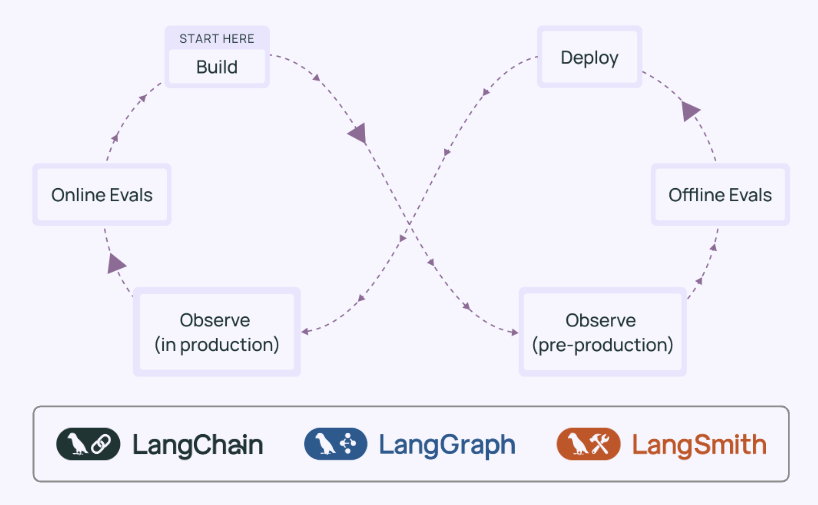

# AI Engineering Lifecycle on LangSmith Platform

Enterprise workshop series teaching the complete AI engineering lifecycle using LangChain, LangGraph, and LangSmith—centered around building a customer support agent for a fictional online technology e-commerce store called TechHub.

<div align="center">
    
</div>

## What You'll Build

A customer support agent system featuring:
- **Multi-agent architecture** with specialized Database and Documents agents coordinated by a Supervisor
- **Human-in-the-loop (HITL)** customer verification with LangGraph primitives
- **Evaluation-driven development** using offline evaluation to identify and fix bottlenecks
- **Production deployment** to LangSmith with online evaluation and data flywheels for continuous improvement

## Quick Setup

This workshop uses [uv](https://docs.astral.sh/uv/) - a fast Python package installer and resolver. If you don't have it:

```bash
# Install uv
curl -LsSf https://astral.sh/uv/install.sh | sh
```

Then set up the workshop:

```bash
# Clone repository
git clone https://github.com/langchain-ai/langsmith-agent-lifecycle-workshop.git
cd langsmith-agent-lifecycle-workshop

# Install dependencies (creates virtual environment automatically)
uv sync

# Configure API keys
cp .env.example .env
# Edit .env and add your API keys:
#   ANTHROPIC_API_KEY=sk-ant-...
#   LANGSMITH_API_KEY=lsv2_pt_...

# Build vectorstore (one-time setup, ~60 seconds)
uv run python data/data_generation/build_vectorstore.py

# Launch Jupyter
uv run jupyter lab
```

### Embedding Configuration (Optional)

By default, the vectorstore uses **HuggingFace embeddings** (local model, no API key required). If you're in an environment where downloading models from HuggingFace is restricted, you can use **OpenAI embeddings** instead:

```bash
# Add to your .env file:
EMBEDDING_PROVIDER=openai

# Rebuild the vectorstore with OpenAI embeddings
uv run python data/data_generation/build_vectorstore.py
```

### Model access: direct keys or the LLM Gateway

Modules 1 to 4 read their models from `config.py`, and Module 6 from `managed_agent/model.py`. Both pick whichever of
the paths below your environment supports, so the notebooks work the same way on all of them.

| Path | Set in `.env` | Notes |
|---|---|---|
| **Direct provider keys** (default) | `OPENAI_API_KEY` and/or `ANTHROPIC_API_KEY` | The simplest setup. With both keys, the other provider becomes the fallback model |
| **LLM Gateway** | `LANGSMITH_GATEWAY="true"` and `LANGSMITH_GATEWAY_API_KEY` | No provider key on your machine, and the Gateway's spend caps and policies apply. `LANGSMITH_API_KEY_GATEWAY` and `LC_GATEWAY_KEY` also work as the key's name |
| **Gateway env file** (machines IT has provisioned) | `GATEWAY_ENV_FILE=/path/to/gateway_env` | Use this when the Gateway variables are only loaded in interactive terminals, so a Jupyter kernel never sees them. On LangChain-managed Macs the file is `/etc/lc_internal/gateway_env` |

Use one path per `.env`. If you set more than one, provider keys win.

**The Gateway key must be workspace-scoped, and its workspace must hold the provider secrets.** The
[LLM Gateway](https://docs.langchain.com/langsmith/llm-gateway) reads provider keys (`OPENAI_API_KEY`,
`ANTHROPIC_API_KEY`, `TYPESAFE_API_KEY` for Jev) from the workspace the API key belongs to, and
[organization-scoped keys aren't supported](https://docs.langchain.com/langsmith/llm-gateway-authentication#use-a-workspace-scoped-key).
A `424 Required workspace secret ... is missing` means that workspace lacks the secret. A `403` usually means the
key lacks the `gateway:invoke` permission. A workspace admin adds the provider secrets and issues a service key,
ideally with a spend cap under **LLM Gateway > Cost Controls**. Jev alone can target another workspace with `JEV_WORKSPACE_ID`.

This covers chat models (`langchain-anthropic>=1.5.1` / `langchain-openai>=1.4.1`, already the repo minimums).
If `EMBEDDING_PROVIDER=openai`, embeddings need their own Gateway setup, since `LANGSMITH_GATEWAY` doesn't
cover them:

```bash
OPENAI_API_KEY="<workspace-scoped-langsmith-key>"
OPENAI_BASE_URL="https://gateway.smith.langchain.com/openai/v1"
```

**Check your setup before Module 1:**

```bash
uv run python verify_setup.py              # prints the active path and models, then calls each model once
uv run python verify_setup.py --no-calls   # resolve and print only
```

It prints variable names, never their values, and explains what to fix for a `424`, `401` or `403`.

## Workshop Outline

This workshop consists of three modules that take you from manual tool calling to production deployment:

1. **Module 1: Agent Development** - Build from basics to multi-agent systems with HITL
2. **Module 2: Evaluation & Improvement** - Use eval-driven development to systematically improve agents
3. **Module 3: Deployment & Continuous Improvement** - Deploy to production and build a data flywheel

Advanced (L200) modules build on the same TechHub agent:

4. **Module 4: Deep Agents 101 → 201** - A pricing research deep agent (101), then harness engineering on the support agent: context, middleware, dynamic subagents, verification (201)
5. **Module 5: Advanced Evaluation** - In progress
6. **Module 6: Deploying Agents into Production** - Managed Deep Agents, Agent Server runtime, and sandboxes

📚 To get started, see [workshop_modules/README.md](workshop_modules/README.md)

## Continuous Evaluation (CI/CD)

Every PR that touches agent-relevant code (`agents/`, `tools/`, `evaluators/`, `deployments/`, `evals/`, `config.py`) is automatically evaluated against the Module 2 baseline dataset — the same `correctness` and `total_tool_calls` evaluators from Module 2, wired into GitHub Actions as a merge-blocking regression test rather than something you have to remember to run by hand.

- **See it in code:** [`evals/run_ci_eval.py`](evals/run_ci_eval.py) and [`.github/workflows/eval-regression.yml`](.github/workflows/eval-regression.yml)
- **See it explained:** [`workshop_modules/module_3/section_3_cicd_regression_gate.ipynb`](workshop_modules/module_3/section_3_cicd_regression_gate.ipynb)
- **Demo it live:** run `./scripts/demo_ci_pr.sh` to open a throwaway PR that only touches `evals/DEMO_TRIGGER.md` — no real agent/eval code changes — so you can show the gate triggering and passing (or failing) an audience without needing a real code change every time. Close the PR without merging when you're done.

## Repo Structure

```
langsmith-agent-lifecycle-workshop/
├── workshop_modules/        # Interactive Jupyter notebooks
│   ├── module_1/            # Agent Development (4 sections)
│   ├── module_2/            # Evaluation & Improvement (3 sections + bonus)
│   ├── module_3/            # Deployment & Continuous Improvement (3 sections)
│   ├── module_4/            # Deep Agents 101 (1 section) + 201 harness engineering (2 sections)
│   └── module_6/            # Deploying to production: MDA, runtime, sandboxes (2 sections)
│
├── managed_agent/           # Module 6: the TechHub agent as a Managed Deep Agent (own uv project)
│
├── agents/                  # Reusable agent factory functions
│   ├── db_agent.py          # Database queries (rigid tools)
│   ├── sql_agent.py         # Flexible SQL generation (improved)
│   ├── docs_agent.py        # RAG for product docs & policies
│   ├── supervisor_agent.py  # Multi-agent coordinator
│   └── supervisor_hitl_agent.py  # Full verification + routing system
│
├── tools/                   # Database & document search tools
│   ├── database.py          # 6 DB tools (orders, products, SQL)
│   └── documents.py         # 2 RAG tools (products, policies)
│
├── evaluators/              # Evaluation metrics
│   └── evaluators.py        # Correctness & tool call counters
│
├── evals/                   # CI/CD regression gate
│   ├── run_ci_eval.py       # Runs Module 2 evaluators, gates on threshold
│   └── DEMO_TRIGGER.md      # No-op file for demoing the CI gate via a PR
│
├── deployments/             # Production-ready graph configurations
│   ├── db_agent_graph.py                   # Baseline database agent
│   ├── docs_agent_graph.py                 # RAG documents agent
│   ├── sql_agent_graph.py                  # Improved SQL agent
│   ├── supervisor_agent_graph.py           # Basic supervisor
│   ├── supervisor_hitl_agent_graph.py      # Supervisor with verification
│   └── supervisor_hitl_sql_agent_graph.py  # Complete system (best)
│
├── data/                    # Complete dataset & generation scripts
│   ├── structured/          # SQLite DB + JSON files
│   ├── documents/           # Markdown docs for RAG
│   ├── vector_stores/       # Pre-built vectorstore
│   └── data_generation/     # Scripts to regenerate data
│
├── scripts/                 # Maintenance & demo scripts
│   └── demo_ci_pr.sh        # Opens a throwaway PR to demo the eval gate
│
├── .github/workflows/       # CI/CD
│   ├── eval-regression.yml  # Eval Regression Gate (this section)
│   └── simulate_traffic.yml # Simulated production traffic for demos
│
├── config.py                # Workshop-wide configuration
├── langgraph.json           # LangGraph deployment config
└── pyproject.toml           # Dependencies
```

## Key Concepts Covered

- **Agent Development:** Tool calling, multi-agent systems, supervisor pattern, HITL with interrupts
- **Evaluation & Testing:** Offline evaluation, LLM-as-judge, trace metrics, eval-driven development
- **Deployment & Production:** LangSmith deployments, online evaluation, annotation queues, SDK integration
- **Best Practices:** Factory functions, state management, dynamic prompts, structured outputs, streaming

See [workshop_modules/README.md](workshop_modules/README.md) for detailed breakdown by module.

## Dataset Overview

The **TechHub dataset** is a high-quality synthetic e-commerce dataset:
- **50 customers** across consumer, corporate, and home office segments
- **25 products** (laptops, monitors, keyboards, audio, accessories)
- **250 orders** spanning 2 years with realistic patterns
- **439 order items** with product affinity patterns
- **SQLite database** (156 KB) with full schema and indexes
- **30 documents** (25 product specs + 5 policies) for RAG

All data is ready to use! See `data/data_generation/README.md` for details.

## Additional Resources

### Documentation
- **Data Generation Guide:** `data/data_generation/README.md` - Complete dataset documentation
- **Database Schema:** `data/structured/SCHEMA.md` - Full schema reference
- **RAG Documents:** `data/documents/DOCUMENTS_OVERVIEW.md` - Document corpus guide
- **Agent Architecture:** `agents/README.md` - Agent factory patterns

### External Links
- [LangChain Python Docs](https://python.langchain.com)
- [LangGraph Python Docs](https://langchain-ai.github.io/langgraph)
- [LangSmith Platform](https://smith.langchain.com)
- [LangChain Academy](https://academy.langchain.com)

## Prerequisites

### Required (Complete Before Workshop)

Free courses from [LangChain Academy](https://academy.langchain.com):
- [LangChain Essentials - Python](https://academy.langchain.com/courses/langchain-essentials-python) (30 min)
- [LangGraph Essentials - Python](https://academy.langchain.com/courses/langgraph-essentials-python) (1 hour)
- [LangSmith Essentials](https://academy.langchain.com/courses/quickstart-langsmith-essentials) (30 min)

### Recommended (For Deeper Understanding)

- [Foundation: Introduction to LangGraph](https://academy.langchain.com/courses/intro-to-langgraph) (6 hours)
- [Foundation: Introduction to Agent Observability & Evaluations](https://academy.langchain.com/courses/intro-to-langsmith) (3.5 hours)

### Technical Requirements

- **Python 3.10+**
- **API Keys:**
  - LangSmith (free tier: [smith.langchain.com](https://smith.langchain.com))
  - Anthropic or OpenAI (workshop uses Claude Haiku 4.5 by default)
- **Tools:** Git, Jupyter, uv (or pip)

## License

This project is licensed under the Apache License 2.0 - see the [LICENSE](LICENSE) file for details.

Educational workshop materials. Synthetic dataset free to use and distribute.

---

**Ready to begin?** Open `workshop_modules/module_1/section_1_foundation.ipynb` and start building! 🚀
